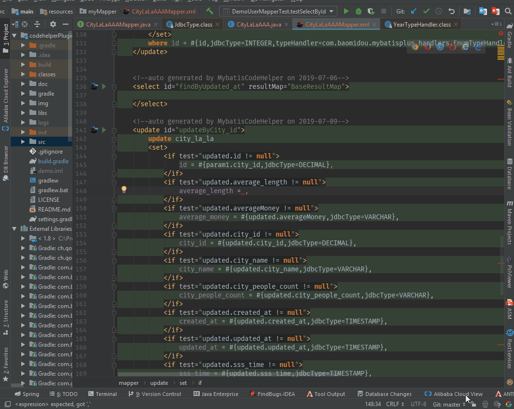
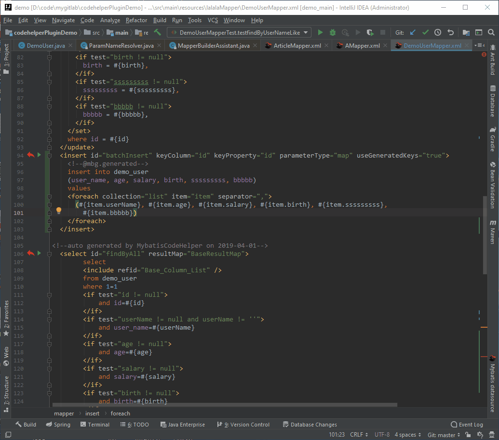
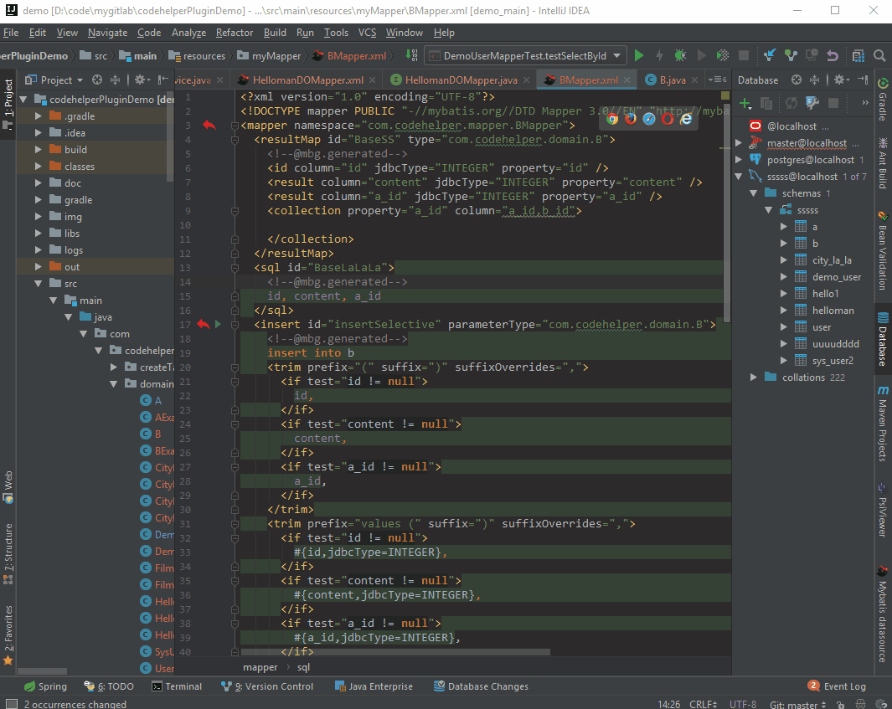
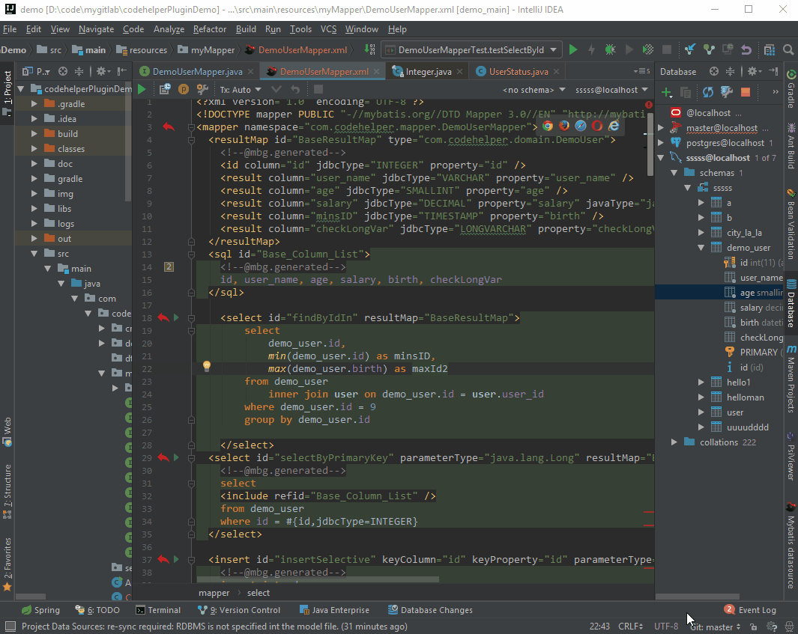
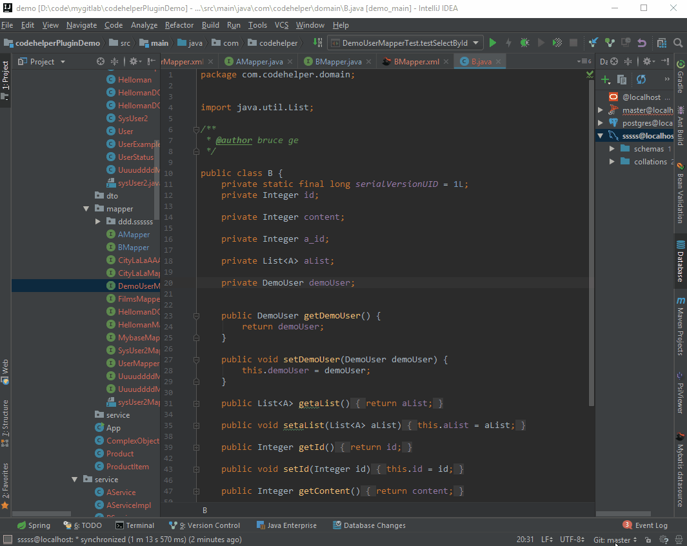
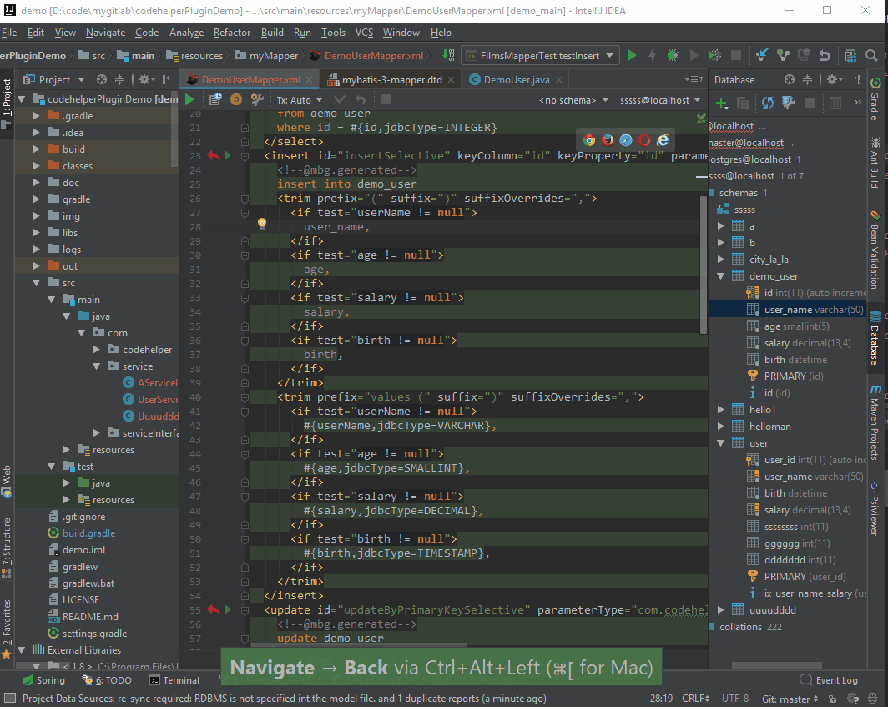
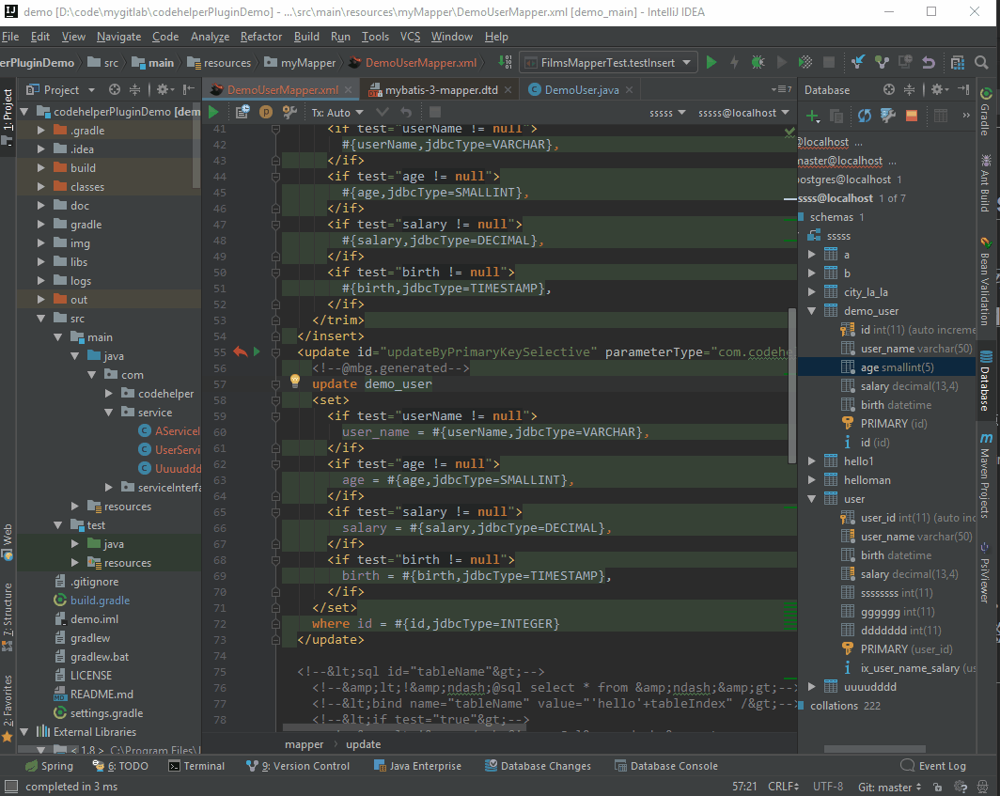

## mybatis param auto complete 


## Complete XML parameters from `parameterType` (3.7.0+)

When an XML statement has no corresponding Mapper interface method, the plugin infers the parameter type from the fully qualified Java class name or [MyBatis type alias](typeAliasSupport.md) declared in `parameterType`. This supports nested properties in `#{...}`, `${...}`, and OGNL, as well as `foreach` collections and items and `bind` values and variables.

If `com.example.OrderFilter` defines `customer.id` and `List<Long> orderIds`, for example, the plugin can complete these properties in the following XML-only statement.

```xml
<select id="findOrders" parameterType="com.example.OrderFilter" resultType="long">
  SELECT id FROM orders
  <where>
    <if test="customer != null and customer.id != null">
      AND customer_id = #{customer.id}
    </if>
    <if test="orderIds != null and !orderIds.isEmpty()">
      AND id IN
      <foreach collection="orderIds" item="orderId" open="(" separator="," close=")">
        #{orderId}
      </foreach>
    </if>
  </where>
</select>
```

When a corresponding interface method exists, completion and inspections still use its parameters. Unresolved parameter or OGNL reference errors require a corresponding interface method.

## mybatis param inspection


## property refid resultMap auto complete


## resultMap column inspection(2.7.2) the plugin will parse select statement with the resultMap.


## resultMap collection association auto complete



## recognize mybatis tags include trim where set, after you add database to Intellij, you can full sql auto complete for it.

trimTag


setTag



