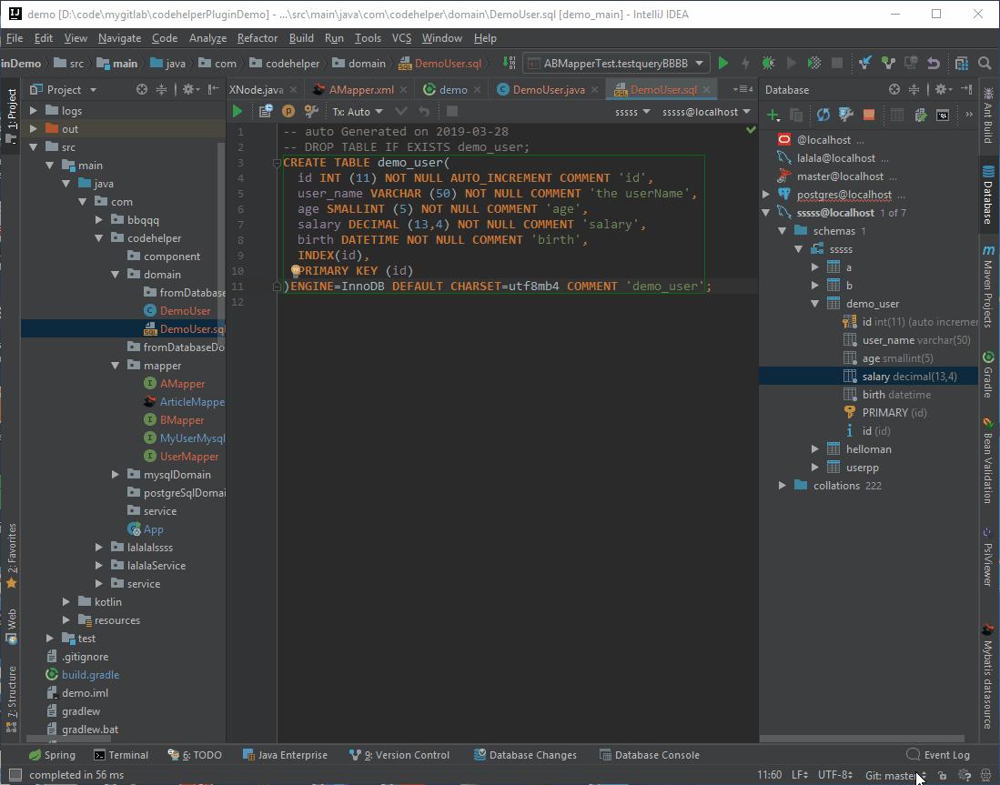
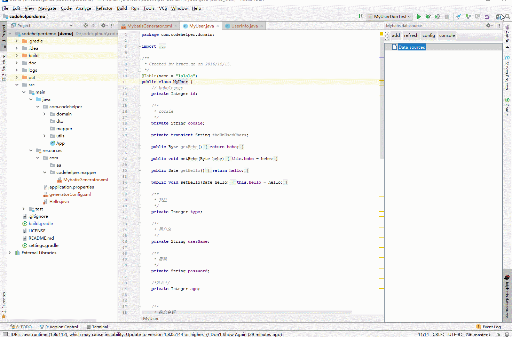
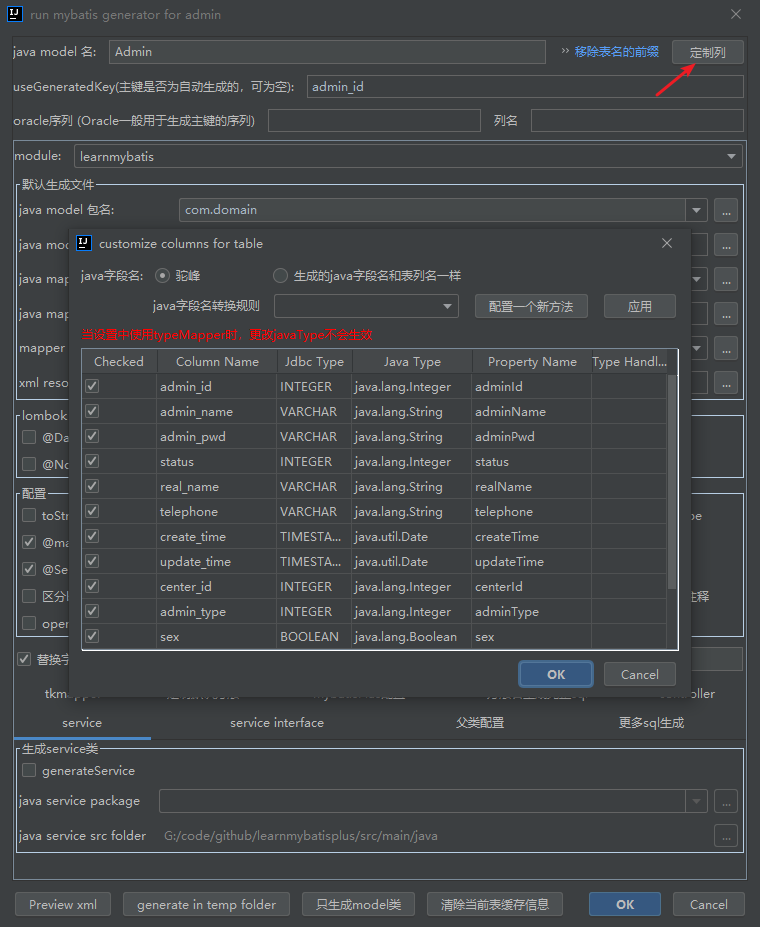
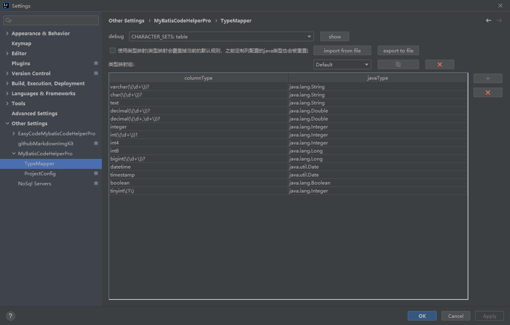

## Sync existing Java entities and Mapper XML from the database (3.7.0+)

When a database table gains columns, you can add the corresponding properties and mappings to an existing Java entity and Mapper XML file. First check that the XML has a `resultMap` whose type resolves to the Java entity.

1. Right-click in the Mapper XML editor and choose **Sync Entity and XML from Database...**. Select a `resultMap` if prompted, then choose a data source and confirm the target table. From the editor, you can use a JDBC data source configured in the plugin or an IDEA Database data source.
2. You can also right-click a single table in the IDEA **Database** tool window, choose the same action, and confirm which Mapper XML file and `resultMap` to sync.
3. Select the columns to add and click **Compare Changes...** to review the proposed Java properties, `resultMap` mappings, and SQL.
4. Select any supported `INSERT`, `UPDATE`, or custom query changes you want, then click **Apply Selected Changes** to write the changes to disk.

The sync preserves existing Java types and mappings. Review constructor mappings, nested property mappings, and SQL the plugin cannot safely update by hand.

## Use Intellij database to generate crud code

after choose the module,the plugin will auto configure java model folder, java mapper folder and resource folder, normally you don't need to change them.

## Use Added database to generate  （current support mysql oracle postgresql sqlserver  mysql version 5.5 and upper  oracle support oracle10g and upper postgresql sqlserver) 

## you can customize columns set their java type and typeHandler

## you can use typeMapper to customize table column type and java type

