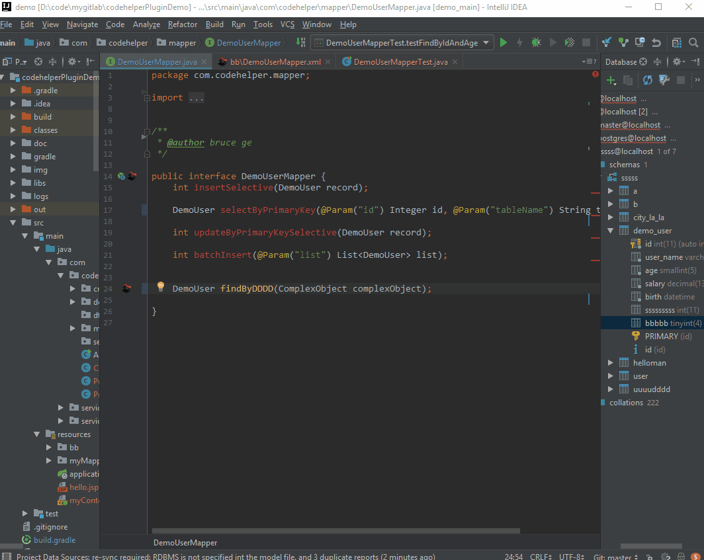
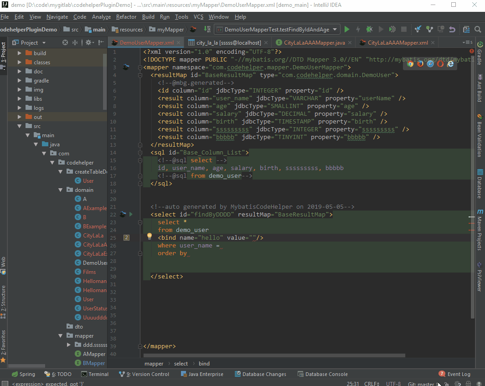
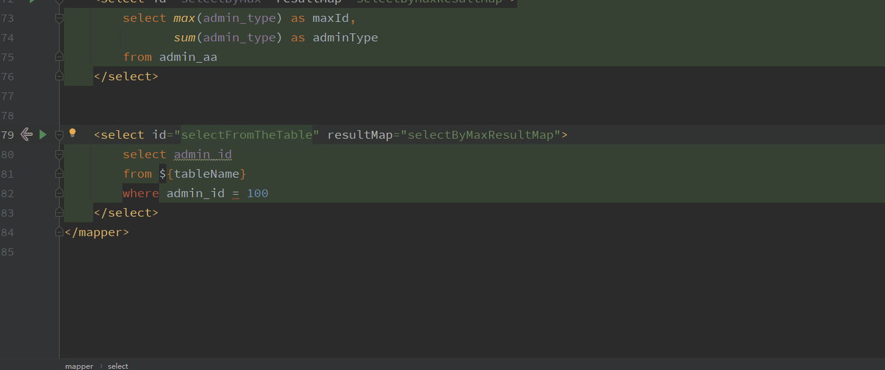
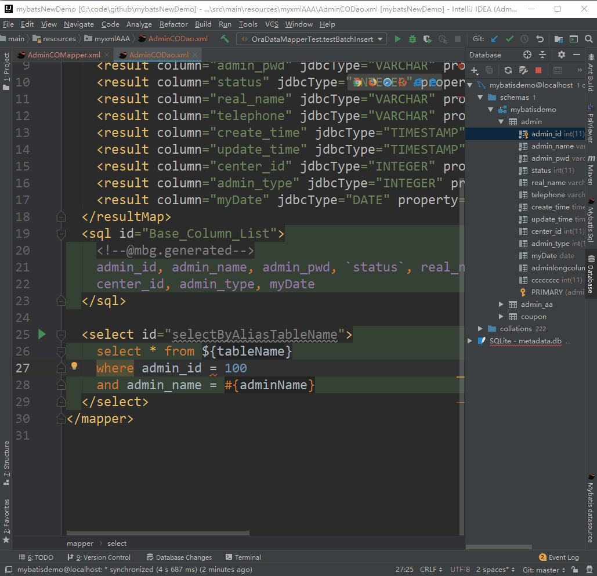
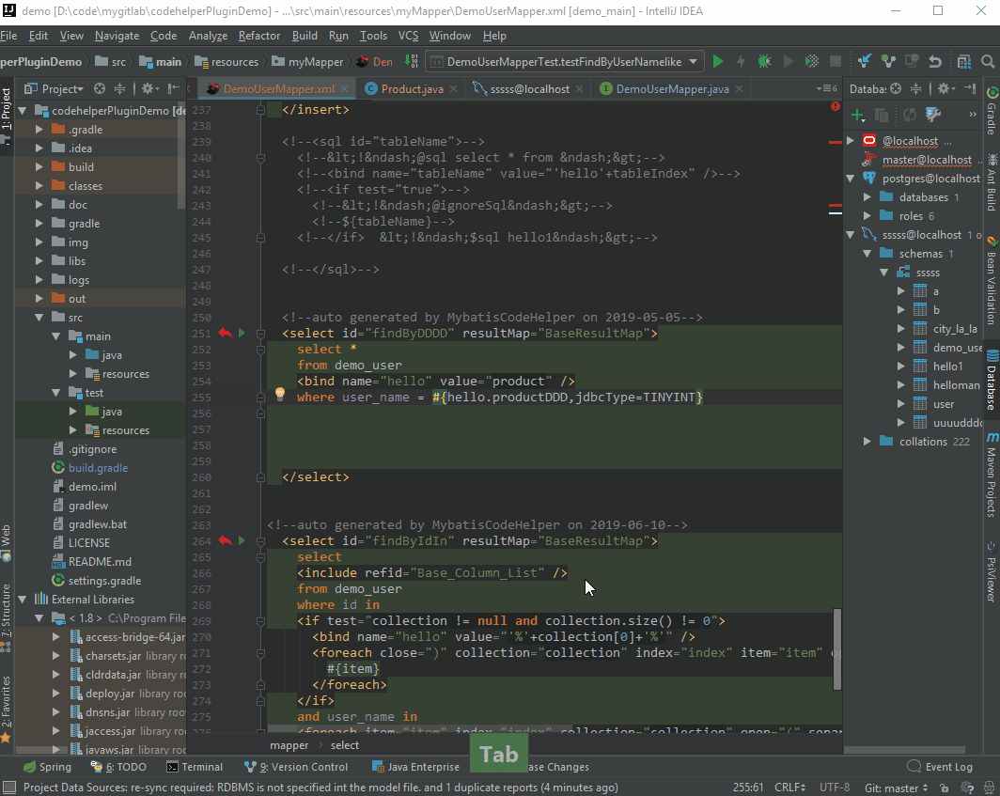
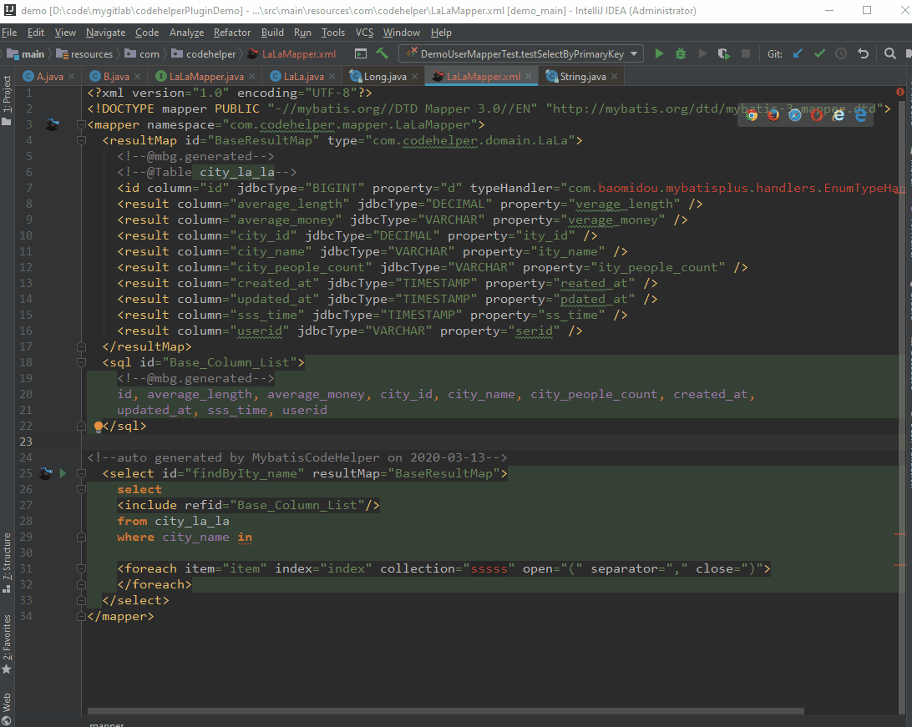
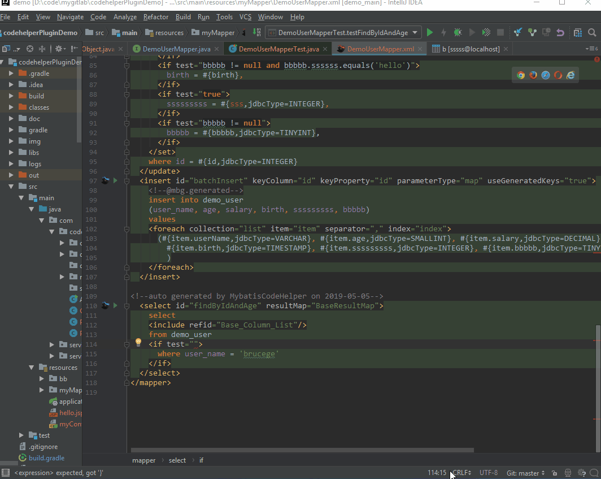

## if test when test

## bind And \${

For $ statement, it can be anything, the sql cant be parsed, you can add a comment to make sql parseable, like this:

Or add a comment before the xml tag

## foreach collection

## ognl method call support and inspection

## ognl single char string compare add toString call

## Chained method calls and property access (3.7.0+)

In OGNL expressions such as `<if test="...">`, `<when test="...">`, and `<bind value="...">`, you can chain method calls and access properties between them. The plugin uses the type returned at each step to resolve the next member and provide completion and reference checks.

For example, in `user.getAddress().getCity().trim()`, `getCity()` returns a `String`, so completion after the next dot offers string methods such as `trim()`. You can also mix property access and method calls, as in `user.getAddress().city.trim()`.
